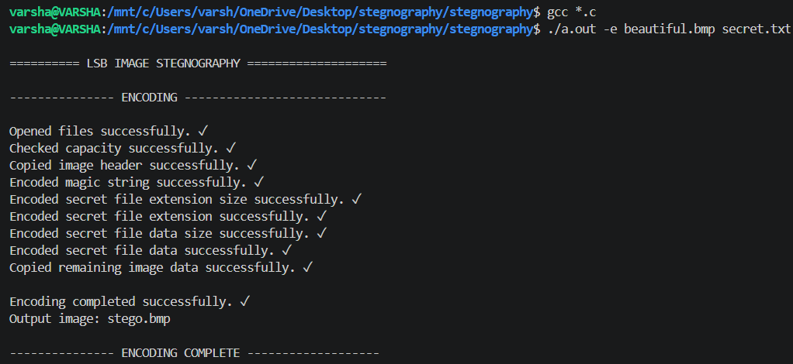
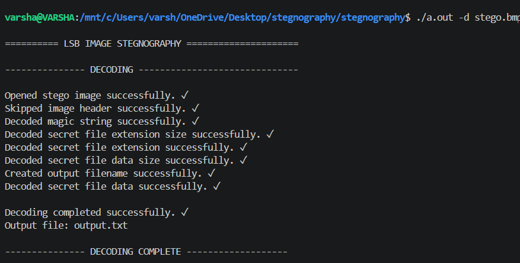

# LSB Image Steganography Using C

## 📌 Project Overview

LSB (Least Significant Bit) Image Steganography is a C programming project that hides secret text data inside a BMP image and retrieves it from the encoded image.

This project demonstrates how bitwise operations and file handling can be used to hide and extract information within an image.

## ✨ Features

- Encode secret text files into BMP images.
- Decode and retrieve hidden text data.
- Store and recover file extensions and data sizes.
- Validate encoding and decoding operations.
- Support command-line arguments.
- Preserve the original image while generating a separate encoded image.

## 🛠️ Technologies Used

- C Programming
- File Handling
- Pointers
- Bitwise Operations
- Structures
- BMP Image Processing

## ⚙️ Compilation

Compile the project using GCC:

```bash
gcc *.c
```

## 🚀 Usage

### Encoding

```bash
./a.out -e beautiful.bmp secret.txt
```

The secret data from `secret.txt` is embedded into `beautiful.bmp`, producing an encoded image named `stego.bmp`.

### Decoding

```bash
./a.out -d stego.bmp
```

The hidden data is extracted from `stego.bmp` into a text file.

## 📸 Project Demonstration

### 1. Encoding Process

This screenshot demonstrates encoding secret text into a BMP image.



### 2. Decoding Process

This screenshot demonstrates extracting the hidden text from the encoded BMP image.



## 🎯 Learning Outcomes

- Understanding Least Significant Bit (LSB) steganography.
- Applying bitwise operations in C.
- Working with binary files and file handling.
- Implementing command-line arguments.
- Understanding encoding and decoding workflows.

## 👩‍💻 Author

**Varsha M**

GitHub: [varsha1907-m](https://github.com/varsha1907-m)
